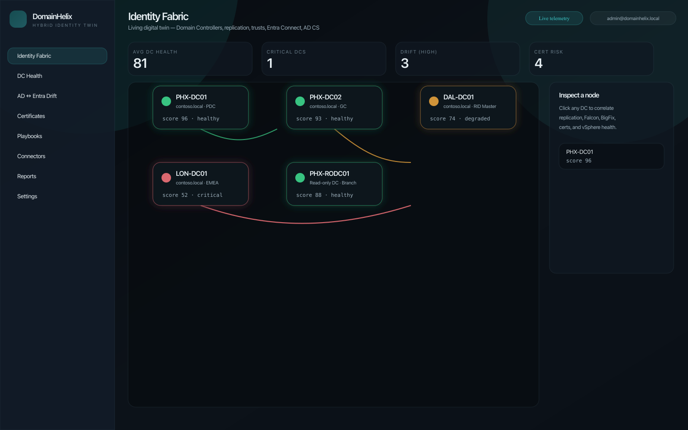
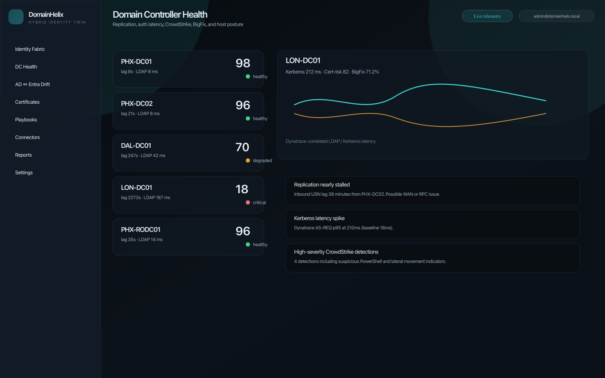
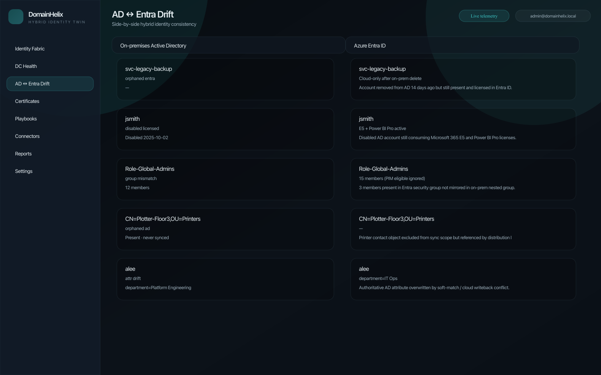
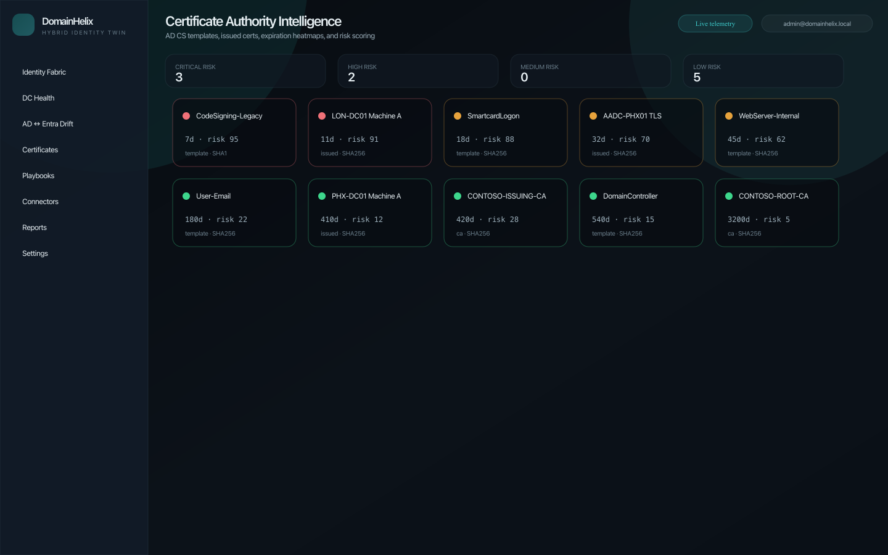
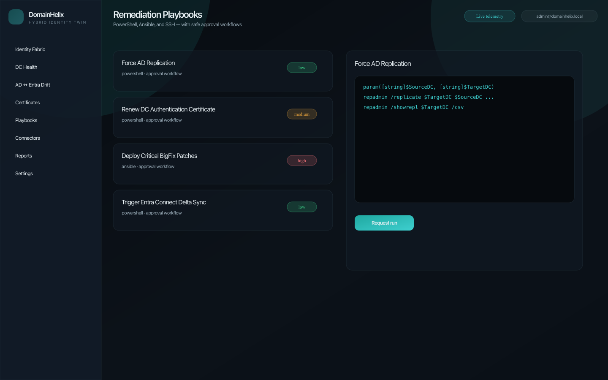
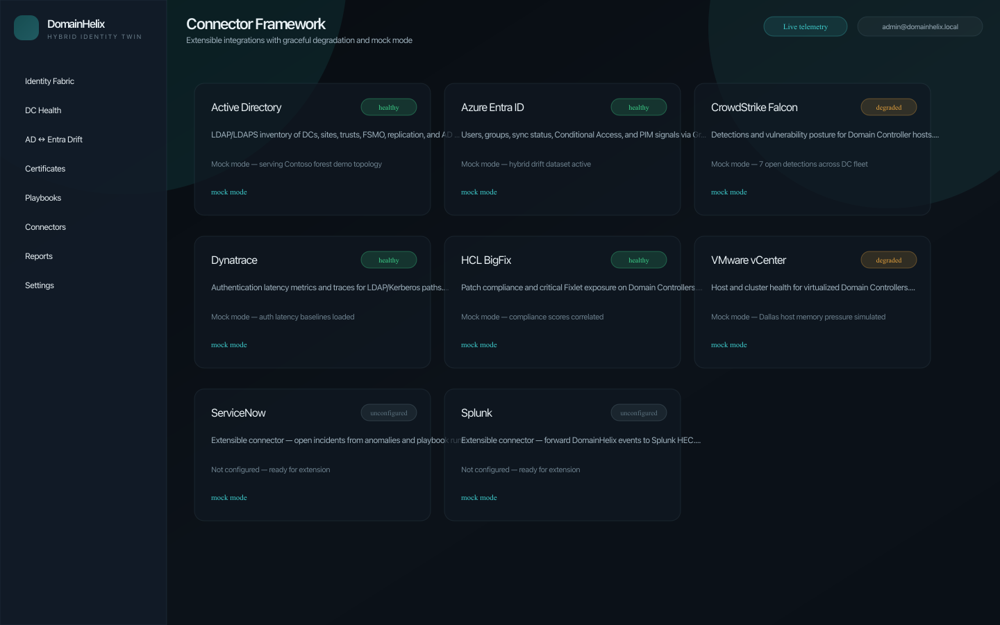
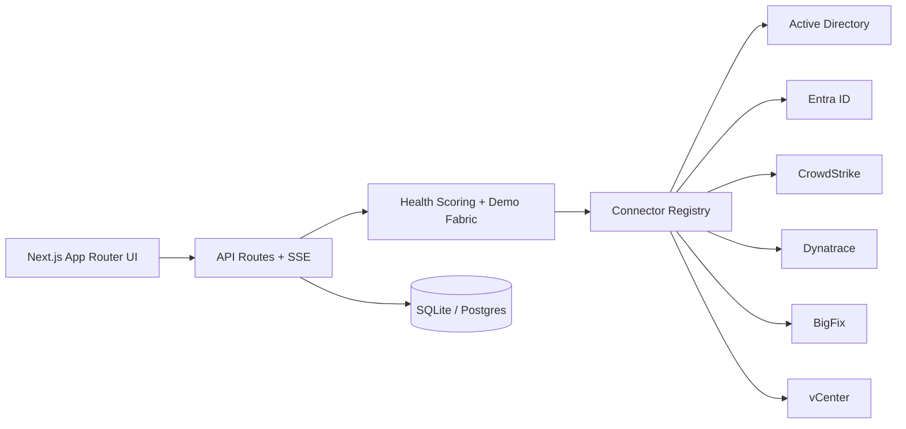

<p align="center">
  
</p>

<h1 align="center">DomainHelix</h1>

<p align="center">
  <strong>A living digital twin of hybrid identity infrastructure.</strong><br/>
  See Active Directory, Entra ID, certificates, detections, and host posture<br/>
  as one calm, correlated fabric — not a pile of consoles.
</p>

<p align="center">
  <a href="#quick-start"></a>
  <a href="LICENSE"></a>
  <a href="#connectors"></a>
  
</p>

---

DomainHelix is built for the people who live between forests and tenants — identity engineers, security analysts, and infrastructure owners who need one place where **Domain Controllers, Entra Connect, AD CS, CrowdStrike, Dynatrace, BigFix, and VMware** finally make sense together.

The graph is the emotional center. Everything else orbits it.

## Screenshots

| Identity Fabric | DC Health |
| --- | --- |
|  |  |

| AD ↔ Entra Drift | Certificate Intelligence |
| --- | --- |
|  |  |

| Remediation Playbooks | Connectors |
| --- | --- |
|  |  |

## Features

| | Capability |
| --- | --- |
| 🧬 | **Interactive identity fabric** — React Flow graph of DCs, sites, trusts, Entra Connect, certificate chains, and vSphere hosts |
| 💓 | **Real-time DC health scoring** — replication lag, NTDS trends, LDAP/Kerberos latency, cert risk, Falcon severity, BigFix gaps, host pressure |
| 🔀 | **AD ↔ Entra drift detection** — orphans, group mismatches, disabled-but-licensed accounts, sync-scope gaps |
| 🔏 | **AD CS intelligence** — CA/template inventory, expiration heatmaps, weak-crypto flags, risk scoring |
| 🛠️ | **Remediation playbooks** — PowerShell / Ansible / SSH with approval workflows |
| 🎭 | **Role-based views** — Identity Engineer · Security Analyst · Infrastructure Owner |
| 📤 | **Exports** — executive Markdown summary, Mermaid architecture diagram, fabric JSON |
| 🔌 | **Extensible connectors** — mock-first with graceful degradation; ServiceNow & Splunk stubs ready |

## Architecture



Single deployable unit: **Next.js 15 (App Router) + TypeScript + Tailwind + Prisma**.  
Missing credentials never break the UI — DomainHelix falls back to a rich Contoso demo fabric.

See [docs/architecture.md](docs/architecture.md) for more detail.

## Quick start

### Docker (one-liner)

```bash
docker compose up --build
```

Open [http://localhost:3000](http://localhost:3000).

### Local development

```bash
git clone https://github.com/btstevens1984az/domain-helix.git
cd domain-helix
cp .env.example .env
npm install
npm run db:setup
npm run dev
```

Demo admin: `admin@domainhelix.local` / `DomainHelix!Admin`

## Configuration

Copy `.env.example` → `.env`. Key knobs:

| Variable | Purpose |
| --- | --- |
| `DEMO_MODE` | `true` (default) serves mock fabric even when some live creds exist |
| `DATABASE_URL` | SQLite `file:./dev.db` for demo · Postgres for production |
| `AUTH_PROVIDER` | `local` or `entra` |
| `AD_*` / `ENTRA_*` / `CROWDSTRIKE_*` / `DYNATRACE_*` / `BIGFIX_*` / `VCENTER_*` | Live connectors — omit any set to keep mock mode for that source |

**Graceful degradation:** each connector independently reports `mock` vs `live`. ServiceNow and Splunk are intentionally unconfigured stubs for future extension.

### Production Postgres tip

1. Set `provider = "postgresql"` in `prisma/schema.prisma`
2. Point `DATABASE_URL` at Postgres
3. `docker compose --profile postgres up --build`

## Usage walkthroughs

### 1. DC health triage

1. Open **Identity Fabric** — critical nodes pulse coral.
2. Switch to **DC Health** — select `LON-DC01`.
3. Review anomalies: replication stall, Kerberos spike (Dynatrace), Falcon detections, cert expiry.
4. Jump to **Playbooks** → *Force AD Replication* or *CrowdStrike Network Containment* (approval required).

### 2. Certificate risk

1. Open **Certificates** — expiration heatmap surfaces imminent risk.
2. Inspect `LON-DC01 Machine Auth` (11 days) and `CodeSigning-Legacy` (SHA1 / 1024-bit).
3. Request *Renew DC Authentication Certificate*.

### 3. AD ↔ Entra drift

1. Open **AD ↔ Entra Drift**.
2. Filter `high` — disabled accounts still licensed, group membership mismatches, OU sync-scope gaps.
3. Export an executive summary from **Reports** for stakeholders.

## Security model

- **Least privilege by design** for every connector (read-heavy defaults; containment/patch playbooks are explicit and approval-gated).
- Local admin bootstrap for demo; Entra ID / OIDC ready via env.
- Role views reshape emphasis without inventing privileges in demo mode.
- Playbooks that can change production state default to **requiresApproval: true**.
- Never commit real secrets — `.env` is gitignored; use `.env.example` as the contract.

Guidance lives in-app under **Settings**.

## Stack

- Next.js 15 · React 19 · TypeScript · Tailwind CSS 4
- React Flow (`@xyflow/react`) · Framer Motion · Recharts · Lucide
- Prisma · SQLite (demo) / PostgreSQL (prod)
- SSE live telemetry · Zod · bcryptjs

## Roadmap

- [ ] Live LDAP + Microsoft Graph connectors beyond mock payloads
- [ ] Conditional Access & PIM deep-dive panels
- [ ] ServiceNow incident creation from anomalies
- [ ] Splunk HEC event forwarding
- [ ] Multi-forest layout algorithms
- [ ] Signed playbook attestation & change windows

## Contributing

See [CONTRIBUTING.md](CONTRIBUTING.md) and [CODE_OF_CONDUCT.md](CODE_OF_CONDUCT.md).

```bash
npm run lint
npm run build
npm run screenshots   # regenerates docs/images from the running app + live APIs
```

## License

[MIT](LICENSE) © DomainHelix contributors
