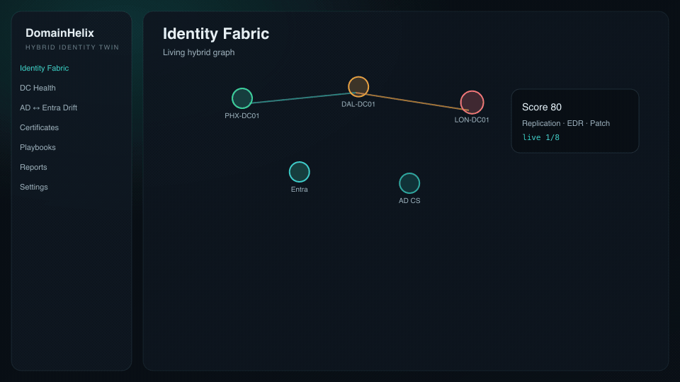
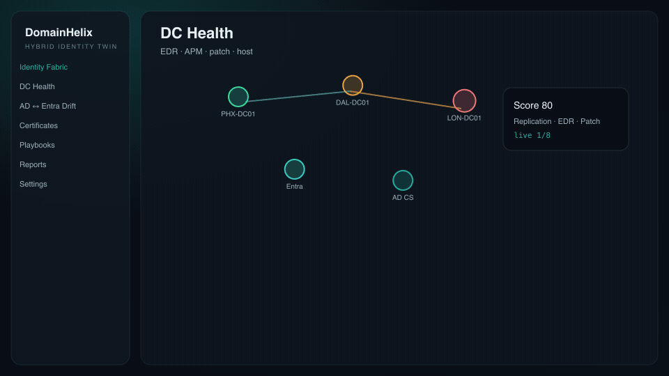
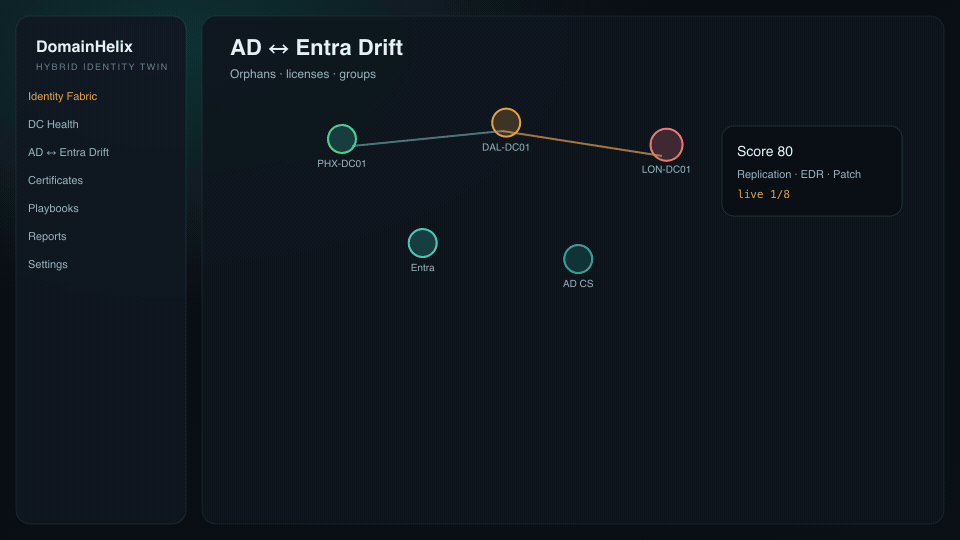
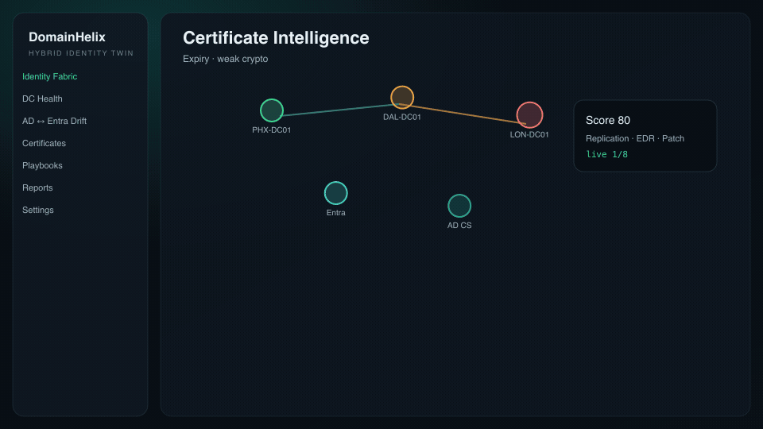
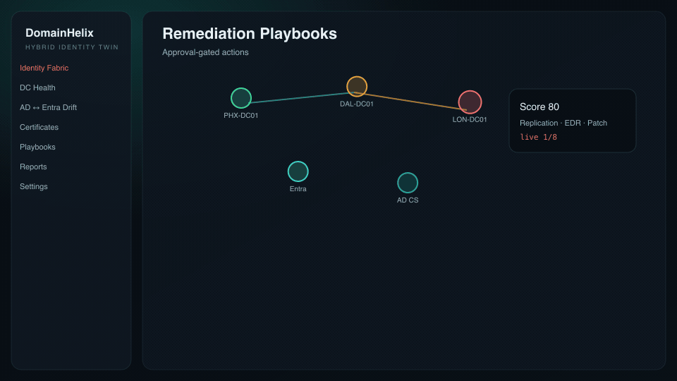
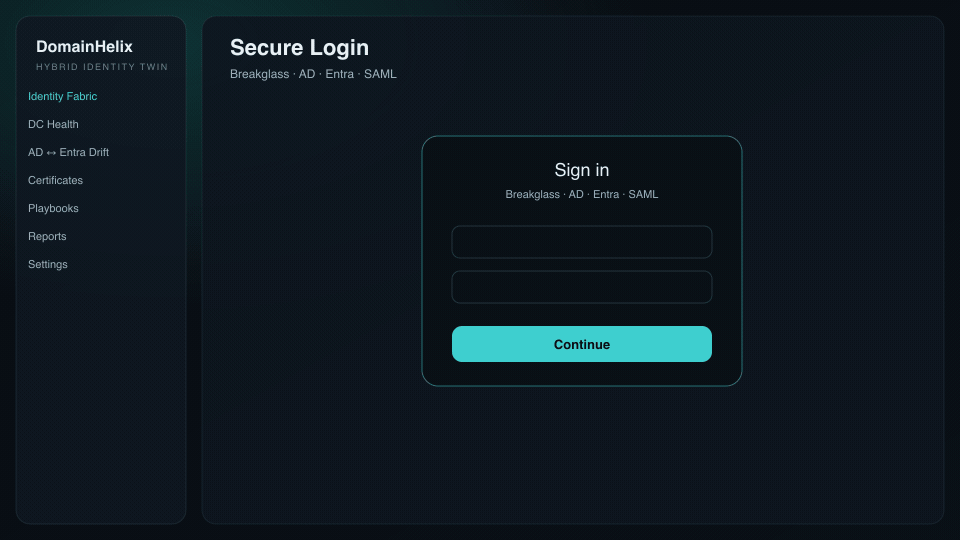
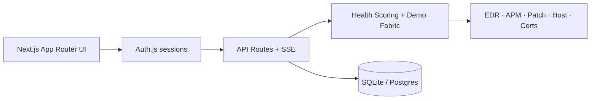

<p align="center">
  
</p>

<h1 align="center">DomainHelix</h1>

<p align="center">
  <strong>A living digital twin of hybrid identity infrastructure.</strong><br/>
  See Active Directory, Entra ID, certificates, EDR posture, and host health<br/>
  as one calm, correlated fabric — not a pile of consoles.
</p>

<p align="center">
  <a href="#quick-start"></a>
  <a href="LICENSE"></a>
  <a href="docs/authentication.md"></a>
  
</p>

---

DomainHelix is built for the people who live between forests and tenants — identity engineers, security analysts, and infrastructure owners who need one place where **Domain Controllers, Entra Connect, AD CS, endpoint detection, APM auth latency, patch compliance, and virtualization host health** finally make sense together.

The graph is the emotional center. Everything else orbits it. Access requires authentication.

## Live walkthroughs

| Identity Fabric | DC Health |
| --- | --- |
|  |  |

| AD ↔ Entra Drift | Certificate Intelligence |
| --- | --- |
|  |  |

| Remediation Playbooks | Secure Login |
| --- | --- |
|  |  |

## Features

| | Capability |
| --- | --- |
| 🔐 | **Multi-method auth** — Breakglass local, Active Directory LDAP, Entra ID OIDC, SAML 2.0 SSO |
| 🧬 | **Interactive identity fabric** — React Flow graph of DCs, sites, trusts, Entra Connect, certificate chains, and virtualization hosts |
| 💓 | **Real-time DC health scoring** — replication lag, NTDS trends, LDAP/Kerberos latency, cert risk, EDR severity, patch gaps, host pressure |
| 🔀 | **AD ↔ Entra drift detection** — orphans, group mismatches, disabled-but-licensed accounts, sync-scope gaps |
| 🔏 | **AD CS intelligence** — CA/template inventory, expiration heatmaps, weak-crypto flags, risk scoring |
| 🛠️ | **Remediation playbooks** — PowerShell / Ansible / SSH with approval workflows |
| 🎭 | **Role-based views** — Identity Engineer · Security Analyst · Infrastructure Owner |
| 📤 | **Exports** — executive Markdown summary, Mermaid architecture diagram, fabric JSON |

## Architecture



Single deployable unit: **Next.js 15 (App Router) + TypeScript + Tailwind + Prisma + Auth.js**.  
Missing telemetry credentials never break the UI — DomainHelix falls back to a rich Contoso demo fabric.

See [docs/architecture.md](docs/architecture.md).

## Quick start

### Docker (one-liner)

```bash
docker compose up --build
```

Open [http://localhost:3000](http://localhost:3000) and sign in with breakglass credentials from `.env.example`.

### Local development

```bash
git clone https://github.com/btstevens1984az/domain-helix.git
cd domain-helix
cp .env.example .env
npm install
npm run db:setup
npm run dev
```

### Default breakglass (change immediately)

| | |
| --- | --- |
| Email | `breakglass@domainhelix.local` |
| Password | `ChangeMe-DomainHelix-Breakglass-2026!` |
| Env vars | `BREAKGLASS_EMAIL` / `BREAKGLASS_PASSWORD` (+ `AUTH_SECRET`) |

After login you land on **Identity Fabric**.

## Authentication

| Method | Guide |
| --- | --- |
| Breakglass local admin | [docs/authentication.md](docs/authentication.md) |
| Active Directory (LDAP/LDAPS) | [docs/active-directory.md](docs/active-directory.md) |
| Entra ID Enterprise App (OIDC) | [docs/entra-enterprise-app.md](docs/entra-enterprise-app.md) |
| SAML SSO (Entra / Okta / Ping / OneLogin / Google / generic) | [docs/saml-sso.md](docs/saml-sso.md) |

All auth-related variables are documented in [`.env.example`](.env.example).

## Configuration

| Variable | Purpose |
| --- | --- |
| `DEMO_MODE` | `true` (default) serves mock fabric |
| `DATABASE_URL` | SQLite `file:./dev.db` for demo · Postgres for production |
| `AUTH_SECRET` / `NEXTAUTH_SECRET` | Session signing secret |
| `BREAKGLASS_*` | Local emergency admin |
| `AD_*` | On-prem LDAP authentication |
| `ENTRA_*` | Entra OIDC Enterprise Application |
| `SAML_*` | SAML 2.0 IdP federation |

### Production Postgres tip

1. Set `provider = "postgresql"` in `prisma/schema.prisma`
2. Point `DATABASE_URL` at Postgres
3. `docker compose --profile postgres up --build`

## Usage walkthroughs

### 1. DC health triage

1. Open **Identity Fabric** — critical nodes pulse coral.
2. Switch to **DC Health** — select `LON-DC01`.
3. Review anomalies: replication stall, Kerberos spike (APM), EDR detections, cert expiry.
4. Jump to **Playbooks** → *Force AD Replication* or *EDR Network Containment* (approval required).

### 2. Certificate risk

1. Open **Certificates** — expiration heatmap surfaces imminent risk.
2. Inspect `LON-DC01 Machine Auth` (11 days) and `CodeSigning-Legacy` (SHA1 / 1024-bit).
3. Request *Renew DC Authentication Certificate*.

### 3. AD ↔ Entra drift

1. Open **AD ↔ Entra Drift**.
2. Filter `high` — disabled accounts still licensed, group membership mismatches, OU sync-scope gaps.
3. Export an executive summary from **Reports** for stakeholders.

## Security model

- Sessions required for all dashboards and APIs (middleware).
- Breakglass passwords hashed with bcrypt; httpOnly cookies (`Secure` in production, `SameSite=Lax`).
- Least privilege for AD bind accounts, Entra app permissions, and SAML attribute release.
- Playbooks that can change production state default to **requiresApproval: true**.
- Never commit real secrets — `.env` is gitignored.

Guidance lives in-app under **Settings** and in `docs/`.

## Stack

- Next.js 15 · React 19 · TypeScript · Tailwind CSS 4
- Auth.js (NextAuth v5) · bcryptjs · ldapts · @node-saml/node-saml
- React Flow · Framer Motion · Recharts · Lucide
- Prisma · SQLite (demo) / PostgreSQL (prod)

## Roadmap

- [ ] Live LDAP + Microsoft Graph inventory beyond mock payloads
- [ ] Conditional Access & PIM deep-dive panels
- [ ] Multi-forest layout algorithms
- [ ] Signed playbook attestation & change windows

## Contributing

See [CONTRIBUTING.md](CONTRIBUTING.md) and [CODE_OF_CONDUCT.md](CODE_OF_CONDUCT.md).

```bash
npm run lint
npm run build
npm run gifs   # regenerates docs/images/*.gif from the running app
```

## License

[MIT](LICENSE) © Brandon Stevens ([@btstevens1984az](https://github.com/btstevens1984az))
