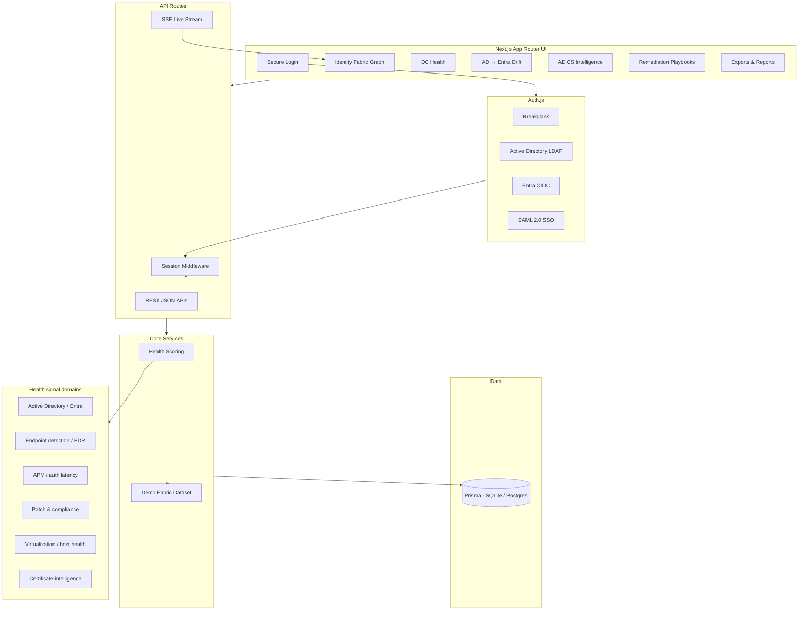

# DomainHelix Architecture

## Design principles

1. **Graph first** — the identity fabric visualization is the emotional and operational center.
2. **Auth before data** — dashboards and APIs require a valid session.
3. **Graceful degradation** — missing live telemetry never breaks the UI; demo fabric fills gaps.
4. **Calm density** — dark-mode glass surfaces, cyan/teal healthy signals, amber/coral risk.
5. **Safe remediation** — playbooks default to approval workflows.
6. **Single deployable** — Next.js API routes + Prisma; Docker Compose for one-command bring-up.
7. **Vendor-neutral signals** — health factors speak in capability language (EDR, APM, patch, host), not product brands.

## Auth docs

- [authentication.md](./authentication.md)
- [active-directory.md](./active-directory.md)
- [entra-enterprise-app.md](./entra-enterprise-app.md)
- [saml-sso.md](./saml-sso.md)
