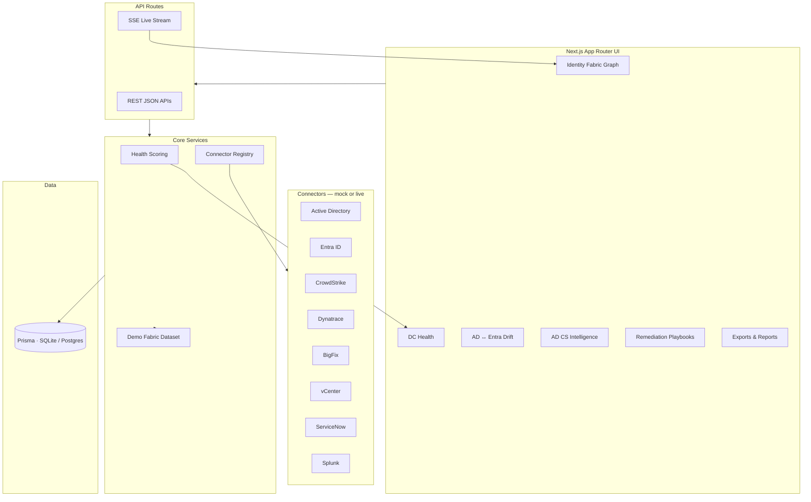

# DomainHelix Architecture

## Design principles

1. **Graph first** — the identity fabric visualization is the emotional and operational center.
2. **Graceful degradation** — missing credentials never break the UI; mock mode fills gaps.
3. **Calm density** — dark-mode glass surfaces, cyan/teal healthy signals, amber/coral risk.
4. **Safe remediation** — playbooks default to approval workflows.
5. **Single deployable** — Next.js API routes + Prisma; Docker Compose for one-command bring-up.
